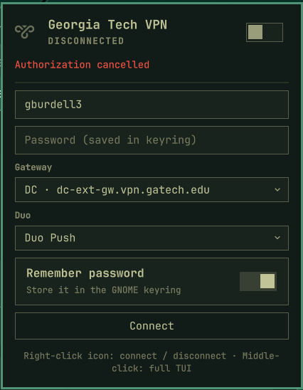
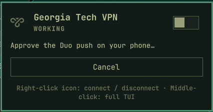
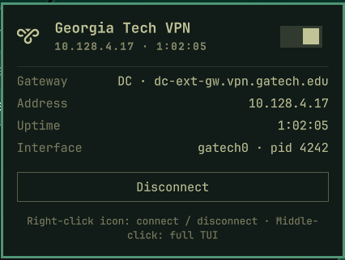
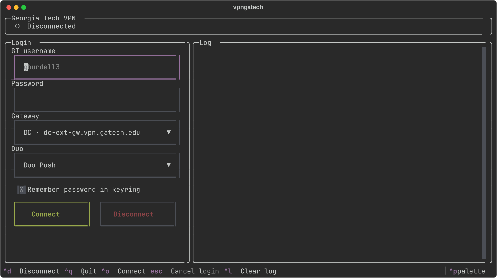
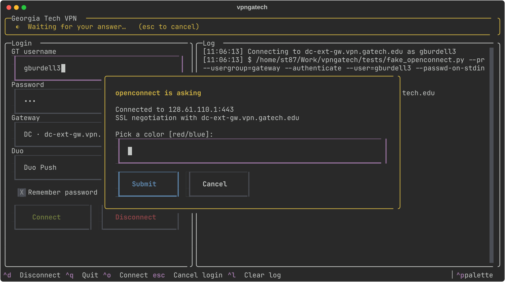
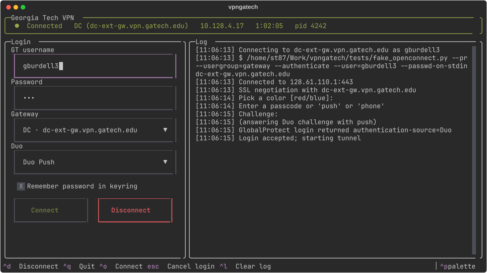

# vpngatech

Log in to the Georgia Tech GlobalProtect VPN (`vpn.gatech.edu`) from
[Omarchy](https://omarchy.org/). It ships two front ends on top of
`openconnect`:

- a **bar widget** for the Omarchy shell with a dropdown login panel, and
- a **terminal UI** (`vpngatech`).

> Unofficial and not affiliated with Georgia Tech. Screenshots use a fake
> username and a fake `openconnect`; no real credentials appear in this repo.

## Bar widget

Docks next to the network icon. Left-click opens the panel, right-click
connects or disconnects with the saved password, middle-click opens the TUI.
The icon dims when disconnected, pulses while working, and turns red on error.

| Login | Waiting for Duo | Connected |
|---|---|---|
|  |  |  |

(The login shot shows the error shown after dismissing the authorization dialog.)

Because the bar has no terminal for `sudo`, root comes from `pkexec`, so the
Omarchy password dialog appears once Duo is approved.

```bash
./install-plugin.sh                     # copy into ~/.config/omarchy/plugins/
omarchy-shell shell rescanPlugins
omarchy plugin enable st87.vpngatech --before omarchy.network
omarchy restart shell                   # if the running widget doesn't update
```

Keybinding-friendly IPC:

```bash
omarchy-shell st87.vpngatech up         # connect with the saved password
omarchy-shell st87.vpngatech down
omarchy-shell st87.vpngatech toggle     # open/close the panel
```

The widget reads `$HOME/.local/bin/vpngatech`, so install the CLI there (below).

## Terminal UI

```bash
vpngatech           # open the TUI
vpngatech status    # one-line status; exit 1 when disconnected
vpngatech down      # disconnect
```



Anything openconnect asks that the app can't answer itself opens a dialog:





Keys: `enter`/`ctrl+o` connect · `ctrl+d` disconnect · `esc` cancel login ·
`ctrl+l` clear log · `ctrl+q` quit (the VPN stays up).

## Install

Requires Arch/Omarchy with `openconnect`, `uv`, and optionally `libsecret`
(`secret-tool`) for saving your password.

```bash
git clone https://github.com/stravis11/vpngatech ~/Work/vpngatech
cd ~/Work/vpngatech && uv sync
cat > ~/.local/bin/vpngatech <<'EOF'
#!/bin/bash
app="$HOME/Work/vpngatech"
exec "$app/.venv/bin/vpngatech" "$@"
EOF
chmod +x ~/.local/bin/vpngatech
```

Optional app-launcher entry:
`omarchy tui install vpngatech ~/.local/bin/vpngatech float network-vpn`

## How it works

1. **Root up front (TUI).** The TUI checks for a cached sudo timestamp and
   briefly suspends itself to run `sudo -v`, so a Duo push never times out
   behind a password prompt.
2. **Login as you.** `openconnect --protocol=gp --usergroup=gateway --authenticate`
   runs unprivileged against the chosen gateway. The password goes over stdin,
   the Duo `Challenge:` prompt is answered with the selected method (`push`,
   `phone`, or a passcode), and the session cookie is returned.
3. **Tunnel as root.** The cookie is handed to
   `setsid -w openconnect --cookie-on-stdin --background` (via `sudo` or
   `pkexec`), which creates `gatech0`, writes `/run/vpngatech.pid`, and keeps
   running after the UI exits. Disconnect sends `SIGINT` so the session logs off.

GT's portal (`vpn.gatech.edu`) accepts logins but lists no gateways, so
vpngatech logs in to a gateway directly:

| Gateway | Host |
|---|---|
| DC | `dc-ext-gw.vpn.gatech.edu` (default) |
| NI | `ni-ext-gw.vpn.gatech.edu` |

The bar widget talks only to the CLI: `status --json` (polled),
`up --json` (JSON events out; password and prompt answers in on stdin),
and `down --json`.

## Files and privacy

- `~/.config/vpngatech/config.json` — username, gateway, Duo method
- `~/.local/state/vpngatech/openconnect.log` — login and tunnel log
- Password (optional) — GNOME keyring via `secret-tool`, service `vpngatech`.
  Passwords and session cookies are never logged or put on a command line.

## Tests

```bash
uv run --with pytest pytest -q tests
```

`VPNGATECH_OPENCONNECT=/path/to/fake` swaps the openconnect binary;
`tests/fake_openconnect.py` simulates a Duo login (`FAKE_DELAY` sets the Duo wait).
